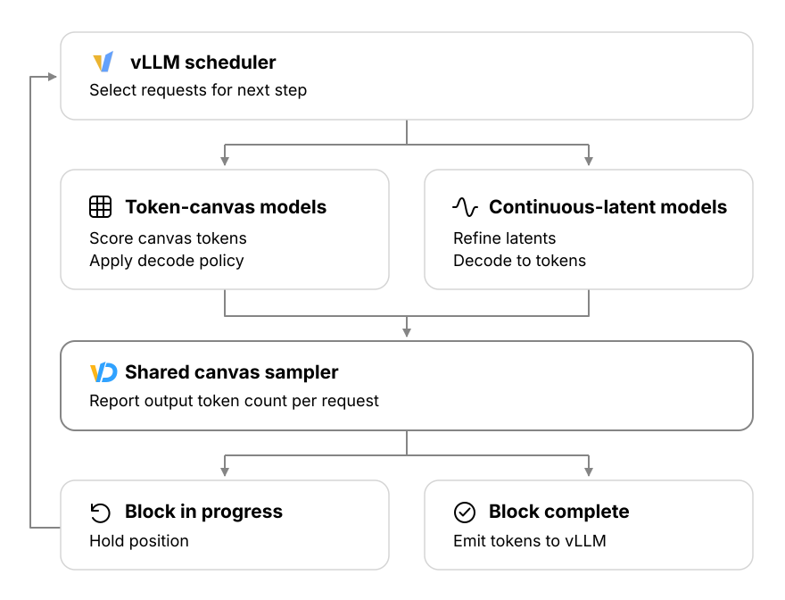

# <sup></sup> vllm-denoisers

[](https://github.com/guan404ming/vllm-denoisers/actions/workflows/docs.yml)
[](pyproject.toml)



Serve diffusion language models through vLLM’s OpenAI-compatible API. Each request refines a block over several steps, then emits the completed tokens.

[Documentation](https://guan404ming.github.io/vllm-denoisers/)

## Supported models

| Model type | Families |
| --- | --- |
| Token-canvas | [DiffusionGemma](https://guan404ming.github.io/vllm-denoisers/models/diffusion-gemma/), [Dream](https://guan404ming.github.io/vllm-denoisers/models/dream/), [Fast-dLLM v2](https://guan404ming.github.io/vllm-denoisers/models/fast-dllm-v2/), [LLaDA-8B](https://guan404ming.github.io/vllm-denoisers/models/llada/), [LLaDA2](https://guan404ming.github.io/vllm-denoisers/models/llada2/), [Nemotron Labs Diffusion](https://guan404ming.github.io/vllm-denoisers/models/nemotron-labs-diffusion/), [SDAR](https://guan404ming.github.io/vllm-denoisers/models/sdar-trado/), [Stable-DiffCoder](https://guan404ming.github.io/vllm-denoisers/models/stable-diffcoder/), [TraDo](https://guan404ming.github.io/vllm-denoisers/models/trado/) |
| Continuous-latent | [Nemotron Labs Sigma](https://guan404ming.github.io/vllm-denoisers/models/nemotron-labs-sigma/) |

## Quick start

On a Linux CUDA host, install the [compatible vLLM build](https://guan404ming.github.io/vllm-denoisers/installation/). From the repository root, install the plugin and serve LLaDA2.

```bash
uv pip install -e .
vllm serve inclusionAI/LLaDA2.0-mini \
  --attention-backend TRITON_ATTN --block-size 32 \
  --max-model-len 2048 --max-num-seqs 8 --max-num-batched-tokens 2048 \
  --generation-config vllm
```

[Send your first request](https://guan404ming.github.io/vllm-denoisers/quickstart/#send-a-request) · [Serving settings](https://guan404ming.github.io/vllm-denoisers/serving/) · [Benchmarking](https://guan404ming.github.io/vllm-denoisers/benchmarking/)
