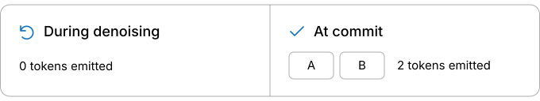

# Runtime architecture

The plugin registers checkpoint architectures through vLLM's `vllm.general_plugins` entry point. Family adapters implement token-canvas or continuous-latent updates. Both use the shared sampler to report emitted tokens to vLLM.

[{ width="100%" }](assets/components.svg)

| Component | Responsibility |
| --- | --- |
| [Family registry](https://github.com/guan404ming/vllm-denoisers/blob/main/denoisers/models/families.py) | Connect a checkpoint architecture to its model adapter, config verifier, and optional tokenizer. |
| [Model state](https://github.com/guan404ming/vllm-denoisers/blob/main/denoisers/runtime/model_state.py) | Prepare input tokens, embeddings, and attention metadata. Install the canvas sampler in the vLLM worker. |
| [FlashAttention backend](https://github.com/guan404ming/vllm-denoisers/blob/main/denoisers/attention.py) | Allocate block-range buffers so that stock FlashAttention can mask block-aligned prefill. |
| [Canvas sampler](https://github.com/guan404ming/vllm-denoisers/blob/main/denoisers/runtime/sampler.py) | Return emitted token IDs and per-request counts to vLLM. The token-canvas sampler also selects LM-head positions and groups requests by decoder. |
| [Canvas transition](https://github.com/guan404ming/vllm-denoisers/blob/main/denoisers/canvas/transition.py) | Apply the policy, track convergence, emit completed tokens, and initialize the next canvas. |
| [Resident/active scheduler](https://github.com/guan404ming/vllm-denoisers/blob/main/denoisers/scheduler/resident_active.py) | Read worker scores and defer selected requests until a later step. |

## Follow a token-canvas step

The worker gathers canvas state by request slot. The decode policy returns updated rows and a step result. While a block is still denoising, the sampler reports zero sampled tokens and rejects the scheduled query positions. vLLM can schedule the same block again without advancing the committed prefix.

[{ width="100%" }](assets/block-output.svg)

The KV policy can select a subset of positions for the next forward. The [draft token hook](https://github.com/guan404ming/vllm-denoisers/blob/main/denoisers/patches/draft_tokens.py) adjusts the draft width that vLLM schedules for each request. An input policy can also store a soft embedding for the next step. Both act on the same before/after canvas transition.

On commit, the sampler reports the emitted token count to vLLM. Policies that do not need commit logits can skip the output-head projection when the request does not ask for logprobs.
