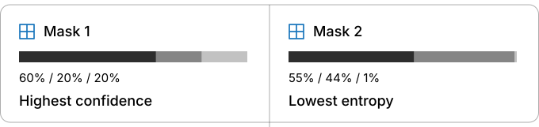
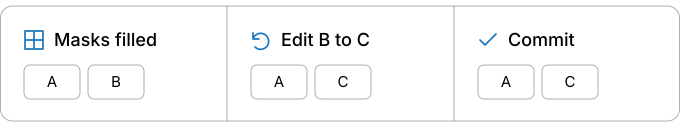

# Decode policies

At each denoising step, the model scores candidate tokens. The decode policy uses those scores to update the canvas and signals when the block is ready to commit.

## Position selection

Confidence measures the probability of the selected token. Entropy measures how spread out the probabilities are across candidates at that position.

Suppose two masks compete for one update and each position has three candidate tokens. With greedy predictions, a confidence ranking picks the first mask (60% versus 55%). An entropy ranking picks the second: almost all its probability lies on just two candidates.

[{ width="100%" }](assets/position-selection.svg)

| Policy | Update rule |
| --- | --- |
| [Confidence-based unmasking](models/llada2.md#decoding) | Fill high-confidence masks first. The transfer schedule sets how many positions to fill, and the confidence threshold can admit more. |
| [Entropy-ranked unmasking](models/dream.md#decoding) | Fill positions with the lowest uncertainty first. The denoising schedule sets how many to fill. |
| [Joint editing](models/llada2.md#decoding) | Fill masks and revise earlier predictions. A separate confidence threshold controls edits. |

## Joint editing

A full canvas can still change. If the model now favors C over B and its confidence clears the editing threshold, the policy replaces B. The revised token stays on the canvas until the block commits. Editing ends when a pass makes no changes or reaches the post-edit step limit.

[{ width="100%" }](assets/joint-editing.svg)
