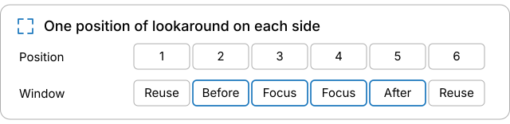

# KV cache reuse

Between full passes, the runtime recomputes selected positions and reuses cached keys and values elsewhere. A KV policy selects the positions.

## Enable a KV policy

Set `kv_policy` in `--hf-overrides` and pass `--no-async-scheduling`. For example, `--hf-overrides '{"kv_policy":"masked"}' --no-async-scheduling`.

| Policy | Positions to recompute |
| --- | --- |
| `masked` | Positions masked before the previous update. |
| `window` | The decoder's focus window, widened by `prefix_look` and `after_look`. The runtime refreshes the canvas when the focus moves. |

- Set `kv_refresh` to a positive step interval for periodic full passes.
- For windowed updates, `llada` and `fast_dllm` expose sub-block focus.
- Disable prefix caching when the policy refreshes committed prefix tokens.

## Masked updates

[{ width="100%" }](../assets/masked-kv-reuse.svg)

## Windowed updates

[{ width="100%" }](../assets/window-kv-reuse.svg)

[Write a KV policy](../extending.md#kv-policy)
