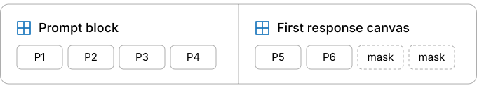
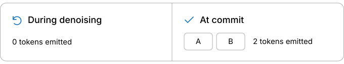

# Block decoding

Each request refines one block at a time. Token-canvas models update tokens directly. Continuous-latent models refine latent states before decoding them into tokens. The example below follows a token-canvas model with four positions per block.

## Prompt alignment

With block-aligned decoding, the prompt can end partway through a block. A six-token prompt fills the first block and leaves P5 and P6 in the next one. The model can generate two tokens in that block before it needs a fresh canvas.

[{ width="100%" }](assets/prompt-alignment.svg)

## Canvas updates

Each `mask` marks an open response position. On each pass, the model scores candidate tokens and the decode policy chooses which positions to update. Here it fills A first and B on a later pass. Other policies can fill several positions together or revise an earlier prediction.

[{ width="100%" }](assets/block-decoding.svg)

## Output at commit

While the block is in progress, the sampler reports zero output tokens to vLLM. At commit, it returns A and B together. P5 and P6 already belong to the prompt. If generation continues, the next block has four positions available for the response.

[{ width="100%" }](assets/block-output.svg)

[Decode policies](decode-policies.md) · [Runtime architecture](architecture.md)
