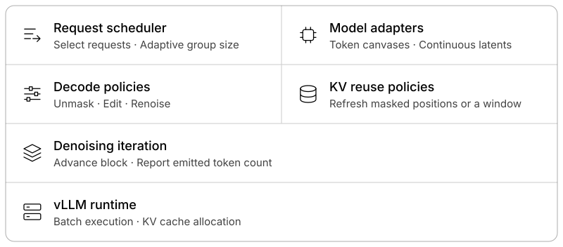
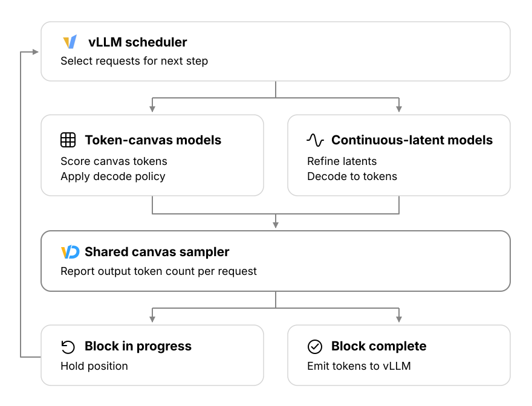

#  vllm-denoisers

Use vLLM to serve models that generate text by refining a block of tokens over several steps.

## Components

## How it works

Read about the [denoising steps](how-it-works.md) or trace a request through the [runtime components](architecture.md).

## Get started

| Task | Start here |
| --- | --- |
| Serve your first model | [Quick start](quickstart.md) |
| Choose a checkpoint and its decoding settings | [Model guide](models.md) |
| Configure serving | [Batch limits](serving.md) · [Request scheduling](scheduling.md) · [KV cache reuse](kv-cache.md) |
| Measure throughput, latency, and accuracy | [Benchmarking](benchmarking.md) |
| Add a policy or model family | [Contributor guide](contributor-guide.md) |
