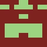

# [{ .org-avatar width="30" height="30" }](https://huggingface.co/dllm-hub/Qwen3-0.6B-diffusion-bd3lm-v0.1){ aria-label="dLLM BD3LM model on Hugging Face" target="_blank" rel="noopener" } dLLM BD3LM

[dllm-hub/Qwen3-0.6B-diffusion-bd3lm-v0.1](https://huggingface.co/dllm-hub/Qwen3-0.6B-diffusion-bd3lm-v0.1){ target="_blank" rel="noopener" }

## Serve

```bash
vllm serve dllm-hub/Qwen3-0.6B-diffusion-bd3lm-v0.1 \
  --max-model-len 2048 --generation-config vllm
```

## Decoding

| Setting | Value |
| --- | --- |
| Policy | `low_confidence` |
| Plugin defaults | 32-token canvas, one token per step |

## Notes

- The checkpoint declares `A2DQwen3LMHeadModel`, so vLLM loads the SDAR adapter with block-causal attention.
- Disable thinking in the chat template (`enable_thinking=False`), as the model card does.
